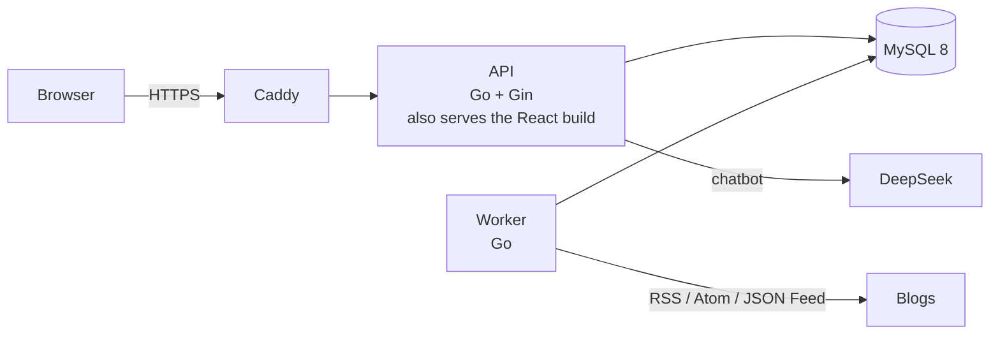

# Gugu Reader

[](https://github.com/ushi02/go_feed/actions/workflows/ci.yml)

Gugu (咕咕, the sound a pigeon makes in Chinese) Reader is a multi-user RSS reader for discovering and reading Chinese independent blogs. Besides the usual "subscribe and read", it ships with a pool of about 1,400 independent blogs that you can search by keyword, and Gugu, a pigeon chatbot that recommends blogs it has actually checked.

Backend: Go (Gin, GORM), MySQL 8. Frontend: React + Vite + TypeScript. Deployment: Docker Compose and Caddy on a single VPS.

[日本語の紹介はこちら](#日本語)

## Status

| Part | State |
|---|---|
| Accounts, subscriptions, reading (read / starred / unread counts, OPML) | Done |
| Background fetching of all feeds with a bounded worker pool | Done |
| Blog pool (about 1,400 feeds) and Chinese full-text search | Done |
| Production setup (Caddy HTTPS, private MySQL, daily backups) | Done; verified locally, not deployed yet |
| Chatbot "Gugu" that recommends blogs (DeepSeek, tool calling, streaming) | Done |

## Architecture



Two Go programs share one database. The **API** answers the browser and never fetches feeds on a timer. The **worker** fetches feeds in the background and never talks to the browser.

Each module (`account`, `subscription`, `entry`, `search`, `chat`) is split into handler → service → repo. Only the repo talks to the database.

## Design decisions

**Feeds and articles are shared; reading state is per user.** A blog is stored once in `feeds` and its articles once in `entries`, however many people subscribe. Reading state lives in `user_entries(user_id, entry_id, read_at, starred_at)`. Every query on user data filters by `user_id`.

**Fan-out on write.** When the worker stores a new article, it inserts one `user_entries` row for each subscriber. A new subscriber gets the 20 most recent articles by publish date. Reads become one indexed query per user, at the cost of more writes. That trade-off fits a reader, where people read far more often than blogs publish.

**Worker scheduling without a queue.** Workers claim due feeds with `SELECT ... FOR UPDATE SKIP LOCKED` plus a lease, so several workers never fetch the same feed. A goroutine pool caps concurrency at 8. Feeds with subscribers are fetched every 6 hours, pool-only feeds once a day. Fetches use conditional requests (ETag / Last-Modified). After 10 failures in a row (about a week with backoff), or right away on `410 Gone`, a feed is disabled. A manual refresh revives it.

**Chinese full-text search in MySQL, not Elasticsearch.** `entries.search_text` (title + summary) has a `FULLTEXT ... WITH PARSER ngram` index. User input is turned into a boolean-mode query with operators stripped. At this size (about 22,000 articles) a separate search cluster would cost more to run than it gives back. See [docs/learning/full-text-search.html](docs/learning/full-text-search.html) (Chinese).

**SSRF protection for every outbound request.** All feed URLs are untrusted input. The fetcher checks the resolved IP at dial time, which also covers redirects and DNS rebinding, and it rejects private and loopback addresses. It also enforces timeouts and a response size limit.

**Security basics.** Sessions are random tokens stored as hashes, in `HttpOnly`, `SameSite=Lax` cookies that are `Secure` in production. Writes are protected against CSRF by an Origin check. Login and registration are rate limited per client IP, and only the reverse proxy's `X-Forwarded-For` is trusted.

**A chatbot that cannot show made-up blogs.** Gugu (DeepSeek, OpenAI-compatible tool calling) has three tools, all read-only: list the user's subscriptions, search the pool, and propose a blog. A proposal is shown as a card with a subscribe button only after the server has fetched and parsed that blog's feed. Links in the answer that no tool returned are removed, also while the answer streams in, where a URL can arrive split over several pieces. The user ID is bound when the tools are built, never read from the model's arguments. Conversations are stored with tool calls as they were; only the newest 20 messages go to the model, and a reply cut off by a closed page is saved and marked incomplete. Each user may send 50 messages per rolling 24 hours.

**Space control.** For feeds nobody subscribes to, the worker clears the text of all but the newest 30 articles once a day. Rows are kept so deduplication still works. Article text was about 87% of the table.

## Run locally

Requires Docker.

```sh
docker compose up --build
```

Open http://localhost:18080. Go serves both the page and the API on the same origin. MySQL is on port 3308. Migrations (goose SQL in `backend/internal/db/migrations/`) run when the API starts. The worker imports the blog pool each time it starts; repeated imports create no duplicates.

To develop the frontend with hot reload, run the API and worker outside Docker:

```sh
docker compose up -d mysql
cd backend && go run ./cmd/api        # terminal 1
cd backend && go run ./cmd/worker     # terminal 2
cd frontend && npm install && npm run dev   # http://localhost:5173, proxies /api to :8080
```

## Tests

```sh
cd backend && go vet ./... && go test -race ./...
```

Integration tests start a real MySQL 8 with testcontainers-go, so they need Docker; `-short` skips them. The tests use real MySQL rather than SQLite or mocks because the code relies on MySQL features (`SKIP LOCKED`, ngram full-text). A fake RSS server built with `httptest` stands in for real blogs. CI runs `go vet` and `go test -race` on every push.

## Deploy

```sh
cp .env.example .env      # set DOMAIN and the passwords
docker compose -f docker-compose.prod.yml up -d --build
```

Only Caddy publishes ports (80/443) and gets the HTTPS certificate automatically. MySQL and the API are reachable only on the internal network. A backup container dumps the database to `./backups` every day and keeps 7 days.

How this would grow on AWS is described in [docs/rss-reader/deployment.md](docs/rss-reader/deployment.md).

## Configuration

| Variable | Meaning |
|---|---|
| `MYSQL_DSN` | MySQL connection string |
| `STATIC_DIR` | Directory of the built frontend (set in the Docker image) |
| `COOKIE_SECURE` | `1` behind HTTPS |
| `TRUSTED_PROXIES` | IPs / CIDRs of the reverse proxy, for the real client IP |
| `DEEPSEEK_API_KEY`, `DEEPSEEK_MODEL` | Chatbot model access (model defaults to `deepseek-flash`) |

Secrets come only from environment variables. `.env` is never committed.

## Repository layout

```
frontend/                 React pages
backend/
  cmd/api, cmd/worker     the two programs
  internal/
    account subscription entry search chat   modules: handler / service / repo
    fetcher/              RSS fetching, feed discovery, HTML cleaning, SSRF protection
    worker/               scheduling, bounded concurrency, cleanup
    llm/                  LLM client interface, DeepSeek implementation, test fake
    middleware/ httpx/ http/ db/
docs/                     design notes, interview notes, problems met during development (Chinese)
```

## Data source

The blog pool comes from [timqian/chinese-independent-blogs](https://github.com/timqian/chinese-independent-blogs) (MIT License, Copyright (c) 2019 Tim Qian). A snapshot of `blogs-original.csv` and its license are in `backend/internal/subscription/pool/`. Only rows with an RSS address are imported.

## 日本語

**Gugu Reader** は、中国語の個人ブログを「見つけて、読む」ためのマルチユーザー RSS リーダーです。「咕咕（gūgū）」は中国語で鳩の鳴き声（日本語の「ポッポ」）で、伝書鳩がブログの新しい記事を届けてくれる、というイメージです。通常の購読・既読管理に加えて、約 1,400 の個人ブログを集めた「ブログプール」をキーワードで全文検索し、気に入ったブログをその場で購読できます。

- **バックエンド：** Go（Gin、GORM）、MySQL 8。API とバックグラウンドで RSS を取得する worker の 2 プログラム構成です。
- **主な設計：**
  - 記事は全ユーザーで共有し、既読状態だけをユーザーごとに持ちます（書き込み時ファンアウト）。
  - worker は `SELECT ... FOR UPDATE SKIP LOCKED` で、キューを使わずに並行処理します。
  - 中国語の全文検索は MySQL の ngram パーサーで実装しています。
  - 外部 URL へのリクエストはすべて SSRF 対策を通します。
- **テスト：** testcontainers-go で本物の MySQL を起動する統合テストを、CI で `-race` 付きで実行しています。
- **デプロイ：** VPS 1 台に Docker Compose と Caddy（自動 HTTPS）で構成しています。AWS への拡張案は別ドキュメントにまとめています。
- **チャットボット「咕咕（クークー）」：** DeepSeek のツール呼び出しでブログを推薦します。推薦されたブログは、サーバーが実際に RSS を取得・解析して確認できたものだけがカードとして表示され、モデルが作り出した存在しないリンクは、ストリーミング中でも削除されます。

日本の Go バックエンドのインターンシップに応募するためのポートフォリオで、作者自身も毎日使っています。
