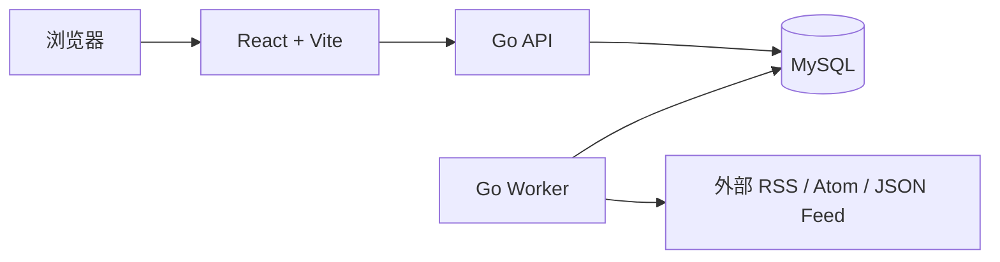
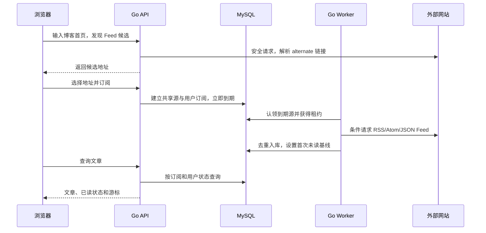

# 架构与数据流

## 组件

MySQL 保存用户、会话、订阅源、文章和用户阅读状态。一个源只抓取一次；用户通过订阅关系看到共享文章。API 不承担定时抓取，Worker 不直接响应浏览器。登录限流目前保存在 API 进程内。

## 添加订阅

多个 Worker 用 MySQL `FOR UPDATE SKIP LOCKED` 和租约协作。抓取在事务外完成，写回前核对租约；文章唯一索引使重试安全。源站请求有大小、时间和并发上限，并在每次连接时拒绝私网地址。

## 阅读状态

每条用户订阅保存 `read_through_entry_id`。小于等于水位的文章默认已读，大于水位的文章默认未读；`entry_states` 只保存用户主动改变的例外和收藏。新订阅已有源时，最近 20 篇默认未读；新源首次抓取后设定同样的基线。批量标已读推进水位，不为每篇文章插入一行。
