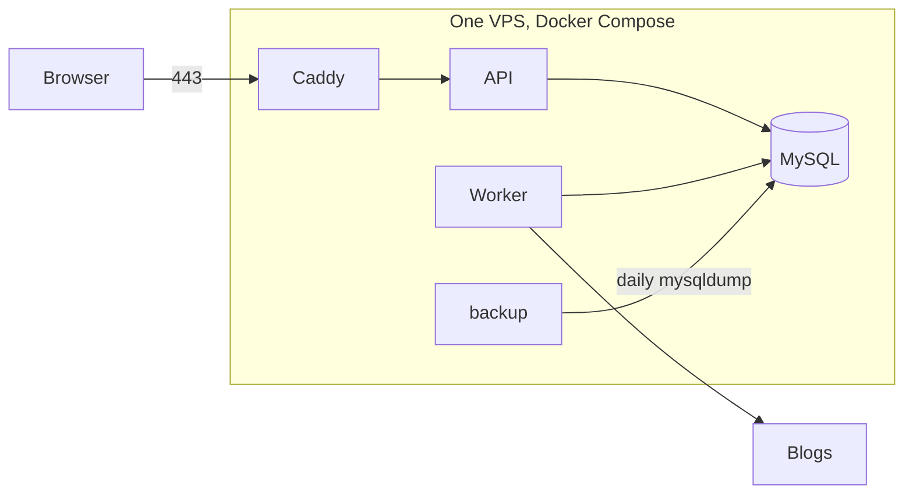
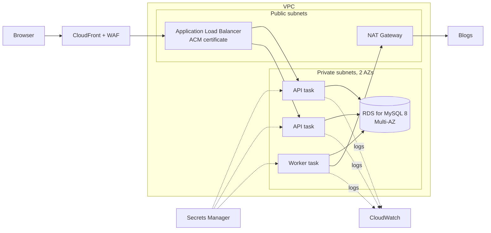

# Deployment and AWS extension design

This document describes how go_feed runs today and how it would move to AWS if it outgrew one server. **The AWS part is a design only. No AWS resources have been created.**

## Today: one VPS

Defined in `docker-compose.prod.yml`:

- Only Caddy publishes ports. It gets and renews the HTTPS certificate.
- The API serves the React build and the JSON API on one origin.
- MySQL has no published port and uses a non-root account.
- A backup container dumps the database once a day and keeps 7 days.

**Why this is the right size now.** It is one user plus a few friends, about 1,400 feeds and about 22,000 articles. One small VM costs a few dollars a month. Every piece can be explained and debugged by one person.

**What it does not give.** If the VM dies, everything is down until it is rebuilt from a backup. Backups sit on the same disk unless they are copied off the machine. Scaling means a bigger VM.

## Target: AWS

| Today | AWS | Why |
|---|---|---|
| Caddy (TLS, reverse proxy) | ALB with an ACM certificate, CloudFront + WAF in front | Managed TLS, health checks, spreads traffic over tasks in two AZs |
| API container | ECS Fargate service, 2+ tasks | No servers to patch; one task can die without downtime |
| Worker container | Separate ECS Fargate service | Scales separately from the API; see "Worker" below |
| MySQL container | RDS for MySQL 8, Multi-AZ | Automatic failover, automated backups with point-in-time restore |
| backup container | RDS automated backups (+ snapshots copied to another region if needed) | Backups leave the machine; restores are a console/CLI action |
| `.env` file | Secrets Manager, injected as environment variables | The code already reads secrets only from env vars, so nothing changes |
| `docker compose logs` | CloudWatch Logs + alarms | Alarms on 5xx rate, worker failures, RDS CPU/storage |
| Image built on the VM | ECR + a CI job that builds and pushes | Same image runs in every environment |

**Why RDS for MySQL, not Aurora or DynamoDB.** Search depends on the MySQL ngram full-text parser, and worker scheduling depends on `FOR UPDATE SKIP LOCKED`. RDS for MySQL 8 supports both with no code change. Aurora MySQL could be considered later for read replicas, but nothing here needs it yet. DynamoDB would mean rewriting search and scheduling.

## What has to change in the code

Most of the code is already ready for several instances. Each item below is either ready or needs a specific change.

1. **Sessions: ready.** Sessions are rows in MySQL, not in memory, so any API task can serve any request. No sticky sessions are needed.

2. **Worker: ready for more than one task.** Workers claim feeds with `SELECT ... FOR UPDATE SKIP LOCKED` and a lease, so two worker tasks never fetch the same feed. A worker that dies mid-fetch loses its lease, and another worker picks the feed up. The daily cleanup locks each feed and re-checks before clearing text, so running it from two workers is safe, only redundant.

3. **Rate limiting: needs a change.** The limiter is in-process. With N API tasks, each task counts separately, so the real limit becomes N times higher. The recommended fix is an AWS WAF rate-based rule on `/api/auth/*`. It counts across all tasks, needs no new database, and keeps the project's no-Redis rule. The in-process limiter stays as a second layer.

4. **Migrations: need a change.** Today the API runs `goose.Up` at start-up without a lock. Two tasks starting together could both try the same migration. Instead, run migrations as a one-off ECS task in the deploy pipeline before the new API tasks start, and remove them from API start-up.

5. **Client IP: config only.** Set `TRUSTED_PROXIES` to the VPC CIDR, since only the ALB can reach the tasks.

6. **SSRF: keep as is.** Fargate tasks have a metadata endpoint at `169.254.170.2`. It is link-local, and `fetcher.allowedIP` already rejects link-local addresses. The check runs at dial time, so it also covers redirects. Even so, the task role gets only the permissions it needs (reading its own secrets, writing logs), so a successful SSRF would find little to steal.

7. **Chatbot streaming: config only.** SSE responses can stay open longer than the ALB's default 60-second idle timeout. Raise the idle timeout, or send a comment line as a heartbeat every ~15 seconds.

## Outbound traffic

The worker fetches from about 1,400 external sites. Tasks in private subnets need a NAT Gateway for that. The NAT Gateway is a fixed hourly cost plus a per-GB charge, and at this size it is likely the most expensive line on the bill. The cheaper alternative is to run only the worker in a public subnet with a public IP and a security group that allows no inbound traffic. The trade-off is a little less isolation. For a personal project I would take that trade.

## Cost

This setup has fixed monthly costs whether anyone uses it or not: the ALB, the NAT Gateway, RDS Multi-AZ (two instances), and two always-on API tasks. Together that is likely ten times the VPS or more. Estimate it with the AWS Pricing Calculator for the target region before building anything.

The smallest useful first step is different: keep the VPS and move only the database to single-AZ RDS. Backups and restores become managed, which removes the biggest risk of the current setup, without paying for the rest.

## Migration order

Each step can be done and checked on its own:

1. Build images in CI and push them to ECR.
2. Create RDS. Restore the latest `mysqldump` into it, then compare row counts with the VPS.
3. Run the worker on ECS against RDS. Check logs for one full round of fetching.
4. Move migrations to a one-off task. Run the API on ECS behind the ALB. Test through the ALB's DNS name.
5. Add the WAF rate-based rule. Switch DNS to the ALB. Keep the VPS running read-only for a few days as a fallback, then shut it down.
